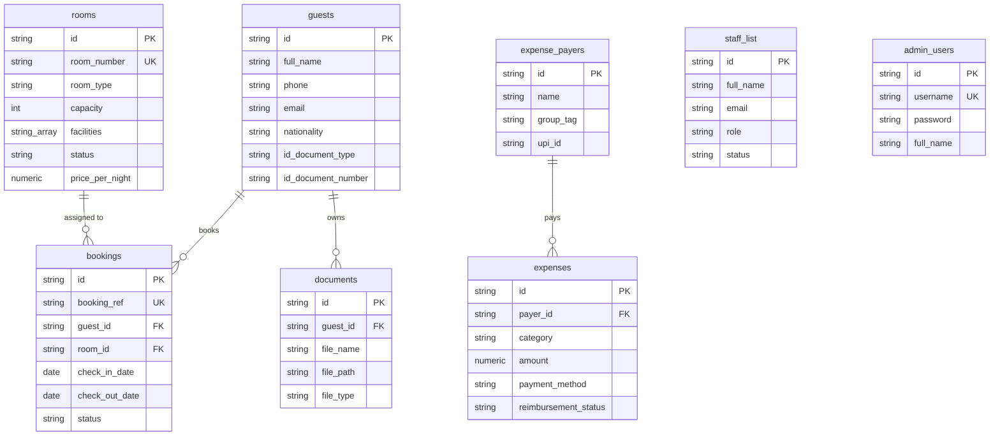

# Somajam Holidays, Parunthumpara — Staff Management System

> A streamlined, full-featured internal operations and staff management portal built for **Somajam Holidays**, located in Parunthumpara, Peerumedu, Idukki, Kerala ([somajamholidays.com](https://somajamholidays.com/)). Engineered to manage 5 1BHK cottages, unified 1-step guest registration and room assignment, rapid phone & walk-in check-in/out workflows, document compliance archives with in-app previews, multi-director expense settlements, and staff administration.

---

## 1. App Identity & Property Overview

* **App Name:** Somajam Holidays Staff Operations Portal
* **Official Website:** [https://somajamholidays.com/](https://somajamholidays.com/)
* **Property Location:** Parunthumpara, Otappalam, Peerumedu, Idukki, Kerala - 685537
* **Property Facilities:** 5 1BHK Cottages, Swimming Pool Access, Free High-Speed Wi-Fi, Dedicated EV Charging Station, Purified Drinking Water, Outdoor Grilling Facilities, Campfire Zone with Audio System, Drivers' Lounge.
* **Core Purpose:** An integrated internal operations portal for front-desk staff and property managers to manage cottage inventory (`No. 1` to `No. 5`), record bookings, execute instant check-in/out workflows, archive guest ID compliance proofs, track multi-account expenses across Directors & Caretaker, and monitor occupancy analytics.

---

## 2. Cottage Inventory (5 1BHK Cottages)

The property operates **5 dedicated 1BHK Cottages** numbered **No. 1** through **No. 5**:

| Cottage | Type | Capacity | Key Facilities & Highlights | Standard Rate |
| :--- | :--- | :---: | :--- | :--- |
| **No. 1** | 1BHK Cottage | 4 Guests | Swimming Pool Access, Free Wi-Fi, EV Charging, Kitchenette, Audio System, Grilling Area | ₹3,500 / night |
| **No. 2** | 1BHK Cottage | 4 Guests | Swimming Pool Access, Free Wi-Fi, EV Charging, Kitchenette, Valley View Patio, Campfire Zone | ₹3,500 / night |
| **No. 3** | 1BHK Cottage | 4 Guests | Swimming Pool Access, Free Wi-Fi, EV Charging, Kitchenette, Private Balcony, Hot Water Shower | ₹3,500 / night |
| **No. 4** | 1BHK Cottage | 4 Guests | Swimming Pool Access, Free Wi-Fi, EV Charging, Kitchenette, Drivers' Lounge Access, Audio System | ₹3,500 / night |
| **No. 5** | 1BHK Cottage | 5 Guests | Swimming Pool Access, Free Wi-Fi, EV Charging, Full Kitchen, Campfire Area, Mountain View | ₹4,000 / night |

---

## 3. Comprehensive Feature Suite

### 🔐 1. Authentication & Session Security
* **Dedicated Login Portal (`/login`)**: Secure credential barrier protecting guest PII, documents, and financial ledgers.
* **Default Admin Credentials**: `admin` / `somajam2026` (with in-app one-click **Auto Fill** helper).
* **Supabase `admin_users` Authentication**: Optional persistent credentials verification against the database with fallback to encrypted session storage.
* **Persistent Sessions**: State preserved in `localStorage` (`somajam_auth` & `somajam_user`).
* **Header Sign-Out**: Instant session termination from the top navigation bar.
* **Crash-Resilient Error Boundary**: Top-level React Error Boundary that isolates uncaught runtime errors and provides a 1-click **"Reset Session & Sign In"** button to recover instantly without clearing valid app states.

---

### ⚡ 2. Two-Tier Booking & Instant Check-In System (`BookingModal.jsx`)
To accommodate both advance phone inquiries and walk-in arrivals, the **Create Booking** modal offers two front-desk modes:

#### ⚡ Mode A: "Quick Booking" (Advance / Phone Reservations)
* **Goal**: Capture phone inquiries in under 15 seconds.
* **Fields**: Guest Full Name `*`, Mobile / Phone Number `*`, Cottage Selection (`No. 1` to `No. 5`), Check-In & Check-Out dates, Guest Count, Staff Notes.
* **Outcome**: Registers a guest profile with ID marked as `Pending Check-In ID` and creates a **Confirmed** reservation. Detailed ID proofs can be captured later upon physical arrival.

#### 📋 Mode B: "Detailed Booking & Instant Check-In" (Walk-Ins & Immediate Arrivals)
* **Goal**: Register guest details, verify government ID, upload document scans, assign cottage, and check in walk-in guests **in a single form submission**.
* **Guest Entry Flexibility**:
  * 🟢 **New Walk-In Guest**: Captures Full Name, Phone, Email, Address, Nationality, ID Document Type (Aadhaar, Passport, Voter ID, Driver's License), and ID Number.
  * 🔵 **Existing Guest Directory**: Quick-select from returning guests to auto-populate data.
* **Multi-File Document Drop Zone**: Attach and stage multiple ID scans/photos (Passport, Aadhaar front/back) simultaneously with 5MB validation.
* **Instant Status Switch**:
  * `🔘 Instant Check-In & Mark Occupied` (Default for walk-ins)
  * `🔘 Confirmed (Upcoming)`
* **Outcome**: Atomically creates the guest record, uploads ID files, creates the booking record, and marks the assigned cottage **Occupied** in one click.

---

### 🛎️ 3. Operations Dashboard (`/`)
* **Property Command Center**: Real-time front desk summary designed for desktop and mobile tablets.
* **Welcome Banner & Quick Triggers**: Direct access to `+ Add Booking`, `+ Add Guest`, and `Upload ID Doc`.
* **Live Operational Metrics**:
  * **Today's Check-Ins**: Confirmed arrivals scheduled for today.
  * **Today's Check-Outs**: Occupied cottages scheduled to depart today.
  * **Occupied Rooms & Occupancy Rate %**: Real-time meter (e.g. 2/5 cottages occupied = 40%).
  * **Available Rooms Count**: Instant view of cottages ready for new walk-ins.
* **Arrivals Action Queue**: List of arriving guests with warning indicators for missing ID proofs and a 1-click `Check In` trigger.
* **Departures Action Queue**: List of departing guests with room numbers, stay dates, and a 1-click `Check Out` trigger.
* **Upcoming Reservations Preview**: Chronologically sorted preview of confirmed reservations across all cottages.

---

### 👥 4. Guest Directory & Compliance Archives (`/guests`)
* **Search & Filter Suite**: Live instant search across Guest Name, Phone Number, Nationality, and ID Document Number.
* **Document Compliance Filter**:
  * `All Guests`
  * `Has ID Uploaded` (Compliant)
  * `Missing ID Document` (Flags profiles needing arrival documentation)
* **Unified Add / Edit Guest Modal (`GuestModal.jsx`)**: Full form for personal contact info, nationality, ID details, notes, plus optional 1-step cottage assignment.
* **Interactive Guest Detail Drawer**: Clicking any guest opens an extensive 3-tab sliding drawer:
  1. **Personal Details**: Contact information, permanent address, nationality, and ID classification.
  2. **Stay History**: All past and active reservations, booking references (`SJM-2026-xxx`), assigned rooms, dates, and stay statuses.
  3. **Document Archives**: List of all uploaded ID documents with file size, upload timestamp, and 1-click triggers to preview or download.
* **Admin-Only Delete**: Admin users can delete guest records (with cascade cleanup of linked bookings).

---

### 📅 5. Bookings & Check-In / Out Hub (`/bookings`)
* **Reservation Lifecycle Management**: Track bookings across `Upcoming`, `Checked In`, `Checked Out`, and `Cancelled` states.
* **Status Filter Tabs**: Quick-filter tabs with dynamic counters (`All`, `Upcoming`, `Checked In`, `Checked Out`, `Cancelled`).
* **Cottage Dropdown Filter**: Filter reservations specifically for `No. 1`, `No. 2`, `No. 3`, `No. 4`, or `No. 5`.
* **Search Filter**: Search by booking reference ID (`SJM-2026-xxx`), guest name, or room number.
* **Double-Booking Prevention Guard**: Algorithmically validates that the selected cottage has no conflicting reservations (`new_check_in < existing_check_out AND new_check_out > existing_check_in`).
* **Interactive Check-In Modal (`CheckInModal.jsx`)**:
  * Displays booking and guest summary.
  * ID Compliance Warning banner if ID was pending during phone booking.
  * In-place ID Type, ID Number, and multi-file document upload fields to complete registration on arrival.
  * Staff check-in notes field.
  * Automatically transitions booking status to `Checked In` and cottage status to `Occupied`.
* **Interactive Check-Out Modal (`CheckOutModal.jsx`)**:
  * Displays stay duration and billing summary.
  * Room inspection checklist ("Room inspected & key returned by guest").
  * Staff departure notes field.
  * Automatically transitions booking status to `Checked Out` and cottage status back to `Available`.
* **Cancel Reservation**: Staff can cancel upcoming reservations with confirmation and toast feedback.

---

### 🏡 6. Cottage Inventory & Availability (`/rooms`)
* **Real-Time Visual Grid**: Detailed cottage cards for `No. 1` through `No. 5`.
* **Cottage Specifications**: Category (`1BHK Cottage`), capacity (4–5 guests), default price per night (₹3,500 – ₹4,000), and facility tags (Swimming Pool, Wi-Fi, EV Charging, Kitchenette, etc.).
* **Occupant Banner**: When a cottage is `Occupied`, an occupant banner appears displaying the current guest's name and their scheduled check-out date.
* **Maintenance Workflow**:
  * 1-Click `Mark Maintenance` button to temporarily pull a cottage out of inventory for repairs, cleaning, or pool servicing.
  * 1-Click `Set Available` button to return the cottage to active inventory.
* **Add Room Modal (`RoomModal.jsx`)**: Admin-only modal to configure new rooms, cottages, pricing, and amenities.

---

### 💰 7. Multi-Account Expense Tracker & Settlement Ledger (`/expenses`)
* **Multi-Payer Ledger**: Built specifically for Somajam Holidays' partnership structure consisting of **5 Directors**, **1 Caretaker**, and a **Common Homestay Account**.
* **Financial Metric Cards**:
  * **Total Outlay Logged**: Cumulative expenditure recorded across all accounts.
  * **Common Pool Outlay**: Expenses paid directly from the common homestay account.
  * **Directors Outlay**: Cumulative out-of-pocket spending funded by the 5 Directors.
  * **Total Pending Reimbursements**: Outstanding out-of-pocket money owed back by the homestay.
* **Live Reimbursement Settlement Summary**: Live calculation alert showing the exact out-of-pocket amounts owed back to each individual Director or Caretaker.
* **Payer Filter Tabs**: Filter transactions by `All Accounts`, `Common Homestay Account`, `Director 1 (Ramesh)`, `Director 2 (Sarah)`, `Director 3 (George)`, `Director 4 (Anish)`, `Director 5 (Deepa)`, `Caretaker (Joy)`, or custom accounts.
* **Multi-Filter & Search Bar**: Filter by expense category (`Utilities`, `Maintenance`, `Staff Wages`, `Guest Amenities`, `Food & Kitchen`, `Govt Taxes`, `Miscellaneous`), payment method (`UPI`, `Cash`, `Bank Transfer`, `Card`), and reimbursement status (`Settled` vs `Pending Reimbursement`).
* **1-Click Settlement Toggle**: Click any badge in the table to toggle an expense between `Pending Reimbursement` and `Settled` instantly.
* **Log Expense Modal (`ExpenseModal.jsx`)**: Record date, payer account, category, amount, payment method, description, and attach bill/receipt scans.
* **Manage Accounts Modal (`ManagePayersModal.jsx`)**: Add custom expense accounts/directors/vendors with category tag, contact phone, and UPI ID.
* **Strict Safety & Authorization Rules**:
  * **Account Deletion Safety Rule**: Blocks deleting any account that has active transactions linked to it.
  * **Transaction Deletion Authorization**: Only the user recorded on that specific transaction (matching the active user identity selector) is authorized to delete it.
* **Dual Persistence Sync**: Transactions and accounts synchronize automatically to both `localStorage` (`somajam_expenses`, `somajam_expense_payers`) and Supabase DB.

---

### 📊 8. Occupancy Analytics, Historical Logs & Staff Directory (`/reports-settings`)
* **Tab 1: Occupancy Analytics**:
  * Live property occupancy rate progress gauge.
  * Total completed stays hosted counter.
  * Total registered guests counter.
  * Cottage-by-cottage occupancy breakdown bars (utilization for No. 1 to No. 5).
  * 1-Click **Export CSV** for monthly occupancy metrics.
* **Tab 2: Historical Stays & Cancellation Logs**:
  * Comprehensive historical archive of all completed guest stays and cancelled bookings.
  * Filterable log showing Booking Ref, Guest Name, Room, Check-in/Out dates, and final status.
  * 1-Click **Export CSV** for hospitality tax, audit, and local police reporting.
* **Tab 3: Staff Directory & Administration**:
  * Directory of internal staff members showing Name, Email, Phone, Role (`Admin` / `Staff`), Designation Title, and Status (`Active`).
  * Admin-only **+ Add Staff Member** modal to register new front-desk employees.

---

### 📁 9. In-App Document Storage & Multi-Format Viewer (`DocumentViewerModal.jsx`)
* **Embedded Preview Modal**: High-performance in-app modal that previews ID scans and receipts without needing external PDF reader extensions.
* **Supported Media Formats**:
  * Image Scans: `.jpg`, `.jpeg`, `.png`, `.webp`, `.gif`, `.bmp`
  * Documents: `.pdf`
  * Staged Camera/Upload files: Real-time object URLs generated via `URL.createObjectURL`
  * Base64 & Supabase Storage remote URLs
* **Compliance Download Button**: 1-click trigger to download original files for police verification or accounting compliance.
* **Dedicated Upload Modal (`DocumentUploadModal.jsx`)**: Direct ID document uploader from the dashboard to attach Passport, Aadhaar, Voter ID, or Driver's License scans to any guest profile.

---

### 🛡️ 10. Offline Aadhaar Secure QR Scanner & Genuineness Verifier (`AadhaarScannerModal.jsx`)
* **100% In-Browser & Zero Data Leak**: Scans and decodes UIDAI Secure QR codes (V2 byte streams and legacy XML barcodes) completely client-side in browser memory without sending resident details or biometric data to any external server.
* **Cryptographic Authenticity Check**: Verifies the embedded 2048-bit digital signature and structural integrity to mathematically guarantee that the card is authentic, issued by UIDAI, and has not been forged or tampered with.
* **Dual Operation Modes**:
  * **Live Camera Viewport**: High-performance camera scanner with animated targeting reticle and camera switcher (front/rear).
  * **Image File Drop Zone**: Upload physical card photos, scanner images, or e-Aadhaar screenshots (.jpg, .png).
  * **Built-In Demo Profiles**: Instant testing/training mode with realistic sample Aadhaar profiles for front-desk staff.
* **Smart Hybrid Accessibility**:
  * **Direct Access Tool**: Standalone verification trigger on the **Dashboard** and **Guests page** (`Scan Aadhaar QR`) with a 1-click **"Register as Guest & Assign Room"** action.
  * **In-Workflow Auto-Fill**: Embedded 1-click **"Scan Aadhaar to Auto-Fill"** triggers inside `BookingModal.jsx`, `GuestModal.jsx`, `CheckInModal.jsx`, and `DocumentUploadModal.jsx` to eliminate manual typing of long Indian names and addresses.
* **Legal Privacy Compliance**: Naturally extracts masked numbers (`XXXX XXXX 1234`), ensuring front-desk compliance with UIDAI regulations and Kerala Police guest verification mandates without storing illegal raw Aadhaar credentials.

---

## 4. User Roles & Permissions Matrix

The portal supports **2 User Roles** (strictly internal staff-only access):

| Feature / Action | Staff | Admin / Owner |
| :--- | :---: | :---: |
| **Login with Credentials / Auto-Fill** | ✅ | ✅ |
| **View Dashboard & Operational Metrics** | ✅ | ✅ |
| **Search & View Guest Profiles** | ✅ | ✅ |
| **Create Booking (Quick & Detailed 1-Step)** | ✅ | ✅ |
| **Attach & Preview Guest ID Documents** | ✅ | ✅ |
| **Process Check-In & Check-Out Workflows** | ✅ | ✅ |
| **Cancel Upcoming Booking** | ✅ | ✅ |
| **Log & Settle Expenses / View Ledgers** | ✅ | ✅ |
| **Delete Guest Profile (with Bookings Cascade)** | ❌ | ✅ |
| **Add / Edit Cottage Inventory & Base Rates** | ❌ | ✅ |
| **Manage / Add Staff Accounts** | ❌ | ✅ |
| **Export Analytics & Stay Records to CSV** | ❌ | ✅ |

---

## 5. Screen Directory & Route Mapping

The application is structured into **7 responsive screens**:

| Route | Screen Name | Key Components & Modals |
| :--- | :--- | :--- |
| `/login` | **Authentication Portal** | Secure login form, default credentials auto-filler, brand styling |
| `/` | **Operations Dashboard** | Metrics cards, Arrivals queue, Departures queue, `BookingModal`, `GuestModal`, `DocumentUploadModal` |
| `/guests` | **Guest Management & Archives** | Compliance filter, search bar, Guest table, Guest Detail Drawer (3 tabs), `GuestModal`, `DocumentViewerModal` |
| `/bookings` | **Booking & Check-In Hub** | Status tabs, cottage filter, `BookingModal`, `CheckInModal`, `CheckOutModal` |
| `/rooms` | **Cottage Inventory & Status** | Cottage cards (No. 1–5), maintenance toggle, occupant card, `RoomModal` |
| `/expenses` | **Expense Tracker & Ledger** | Payer tabs, reimbursement balance card, `ExpenseModal`, `ManagePayersModal`, `DocumentViewerModal` |
| `/reports-settings` | **Analytics & Staff Settings** | Occupancy progress meter, stays history table, staff directory, Add Staff modal, CSV export |

---

## 6. Business Logic & Validation Constraints

1. **Unified Guest & Stay Creation**:
   * Staff can add a guest profile and assign a cottage (`No. 1` to `No. 5`), check-in date, check-out date, and guest count in a single form submission.
2. **Double-Booking Prevention Guard**:
   * Algorithmically prevents overlapping reservations for the same cottage (`new_check_in < existing_check_out AND new_check_out > existing_check_in`).
3. **Automatic Room Status Synchronization**:
   * Checking in a guest automatically sets the cottage status to `Occupied`.
   * Checking out a guest automatically sets the cottage status back to `Available`.
4. **Document Compliance Audit Alert**:
   * Checking in a guest who has no uploaded ID proof triggers an on-screen warning and prompts front-desk staff to capture their ID details immediately.
5. **Expense Account Deletion Safety**:
   * Blocks deleting any expense account/user if transactions are currently linked to them (`expenses.some(e => e.payer_id === id)`).
6. **Expense Deletion Authorization**:
   * Any user can log a transaction on behalf of another account, but **only the user recorded on that transaction** (matching the active user selector) is authorized to delete it.
7. **Dual-Layer Persistence & Zero-Config Offline Resilience**:
   * All mutations synchronize to both Supabase PostgreSQL and browser `localStorage`.
   * If the app is launched in an offline environment or without Supabase credentials configured, it seamlessly falls back to the curated dataset in `initialData.js` and local browser storage.

---

## 7. Technology Stack

* **Frontend Framework:** React 19 + React Router v7
* **Build Tooling:** Vite 8
* **Styling & Icons:** Tailwind CSS v4 + Lucide React Icons
* **Database & Storage (Optional Cloud Sync):** Supabase PostgreSQL + Supabase Storage Bucket (`guest-documents`)
* **Local State & Fallback:** React Context API (`AppContext.jsx`) + Persistent Browser `localStorage`

---

## 8. Database Schema Overview (`supabase_schema.sql`)

The database consists of **8 relational tables** and **1 storage bucket**:



---

## 9. Project Directory Structure

```text
Rejchachan homestay/
├── index.html                     # HTML Entry point
├── package.json                   # Dependencies and npm scripts
├── supabase_schema.sql            # Complete Supabase schema & initial seed data
├── vite.config.js                 # Vite configuration (React + Tailwind v4)
├── public/
│   └── somajam_logo.png           # Somajam Holidays brand logo
└── src/
    ├── App.css                    # Global application styles
    ├── App.jsx                    # Root layout, router, and ErrorBoundary
    ├── index.css                  # Tailwind CSS v4 imports and utility classes
    ├── main.jsx                   # React DOM render root
    ├── components/
    │   ├── common/
    │   │   ├── Modal.jsx          # Reusable accessible modal wrapper
    │   │   ├── StatusBadge.jsx    # Unified color-coded status badge
    │   │   └── Toast.jsx          # Non-blocking notification toasts
    │   ├── layout/
    │   │   ├── Header.jsx         # Live clock, user badge, sign-out button
    │   │   └── Sidebar.jsx        # Navigation links and mobile drawer
    │   └── modals/
    │       ├── AadhaarScannerModal.jsx # Offline Aadhaar QR scanner & genuineness verifier
    │       ├── BookingModal.jsx   # 2-Tab reservation & walk-in check-in
    │       ├── CheckInModal.jsx   # Check-in verification & ID capture
    │       ├── CheckOutModal.jsx  # Check-out & room inspection checklist
    │       ├── DocumentUploadModal.jsx # ID document attachment uploader
    │       ├── DocumentViewerModal.jsx # Multi-format image/PDF previewer
    │       ├── ExpenseModal.jsx   # Log & edit expense transaction modal
    │       ├── GuestModal.jsx     # Add/edit guest with stay assignment
    │       ├── ManagePayersModal.jsx # Add & manage expense accounts
    │       └── RoomModal.jsx      # Admin room creation modal
    ├── context/
    │   └── AppContext.jsx         # Master application state, auth, & API hooks
    ├── data/
    │   └── initialData.js         # Offline seed data (5 rooms, guests, expenses)
    ├── lib/
    │   ├── aadhaarDecoder.js      # UIDAI Secure QR byte decompressor & parser
    │   └── supabase.js            # Supabase JS client initialization
    └── pages/
        ├── Bookings.jsx           # Bookings hub with filters & actions
        ├── Dashboard.jsx          # Real-time front desk command center
        ├── Expenses.jsx           # Multi-director settlement ledger
        ├── Guests.jsx             # Guest directory & compliance drawer
        ├── Login.jsx              # Authentication login screen
        ├── ReportsSettings.jsx    # Occupancy analytics, CSV export, staff list
        └── Rooms.jsx              # 5 1BHK cottage inventory grid
```

---

## 10. Running Locally & Testing

1. **Install Dependencies** (if needed):
   ```bash
   npm.cmd install
   ```

2. **Start Local Development Server**:
   ```bash
   npm.cmd run dev
   ```

3. **Open Application**:
   * **Portal URL:** `http://localhost:5173/`
   * **Default Login:**
     * Username: `admin`
     * Password: `somajam2026`
     *(Or click the "Auto Fill" button on the login screen)*
